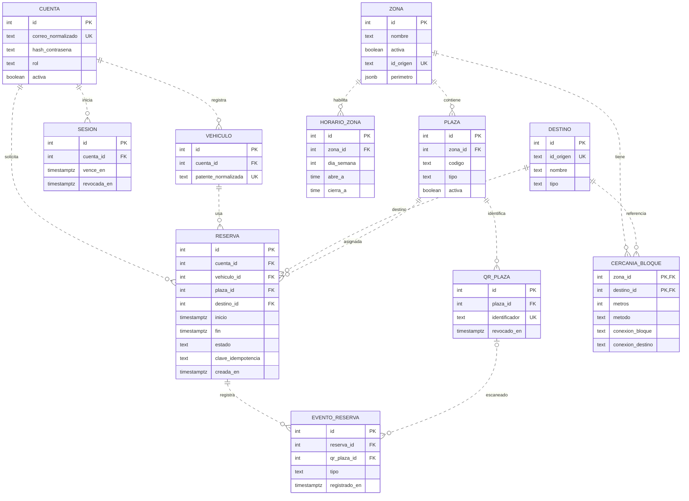

# Modelo de la demo móvil

La cuenta registra una patente. Para reservar, indica una sala o edificio de destino y el intervalo de su visita. La reserva conserva la plaza asignada y los eventos de entrada y salida. [Specs de la demo](../specs/README.md)

## Reglas para implementar

- **Identidad.** Normalizar el correo y la patente antes de validar unicidad. Vincular la reserva a un vehículo de la cuenta. En este modelo, la patente identifica de forma estable al vehículo y una corrección administrativa debe preservar el historial. Verificar que la sesión siga vigente y pueda revocarse al cerrar sesión.
- **Catálogo.** El código visible de la plaza es único dentro de la zona. Una plaza tiene como máximo un QR vigente y puede conservar los revocados. El identificador del QR debe ser único. En el catálogo de San Joaquín, cada bloque se representa como una zona. Cada plaza toma la cercanía de su bloque. La tabla de cercanía conserva una estimación por bloque y destino con su método. La demo combina ubicaciones reales con plazas de prueba. [Catálogo de San Joaquín](../campus-san-joaquin/README.md)
- **Tiempo.** Guardar los instantes de reserva y eventos con `timestamptz`. Interpretar la fecha y hora de una visita en `America/Santiago`. Las reglas semanales de apertura se expresan en hora local. En la demo, la permanencia se valida al solicitar la reserva y se guarda con la confirmación.
- **Reserva.** La salida debe ser posterior a la llegada. Representar la ventana programada como `[inicio, fin)` para permitir reservas contiguas. Proponer tres restricciones de exclusión en PostgreSQL para reservas que ocupan capacidad programada, una por plaza, otra por cuenta y otra por vehículo. La confirmación se hace en una transacción. Una clave única por cuenta y solicitud permite recuperar la misma reserva en un reintento. Validar que la solicitud repetida corresponda a los mismos datos. [Restricciones sobre rangos en PostgreSQL](https://www.postgresql.org/docs/16/rangetypes.html#RANGETYPES-CONSTRAINT)
- **Ocupación real.** Solo puede haber un uso activo por plaza, cuenta o vehículo. Aplicar esa restricción además de la ventana programada. Si una reserva anterior sigue en uso al llegar la siguiente, impedir un segundo check-in y señalar el conflicto. Un check-out o cancelación libera capacidad y conserva el historial. Registrar cada transición en la misma transacción que cambia el estado y usar un evento por reserva y tipo para entrada y salida.
- **QR y ubicación.** La API verifica sesión, plaza, reserva, QR vigente y ventana. Para la llegada también verifica el perímetro. El evento registra la hora del servidor y el QR que se usó. Para la demo, proponer que la ubicación se use al validar la llegada, sin guardar coordenadas personales en el historial.
