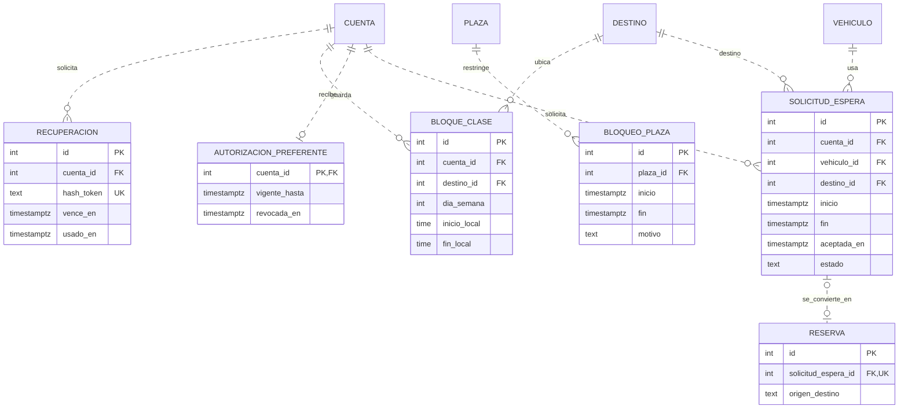
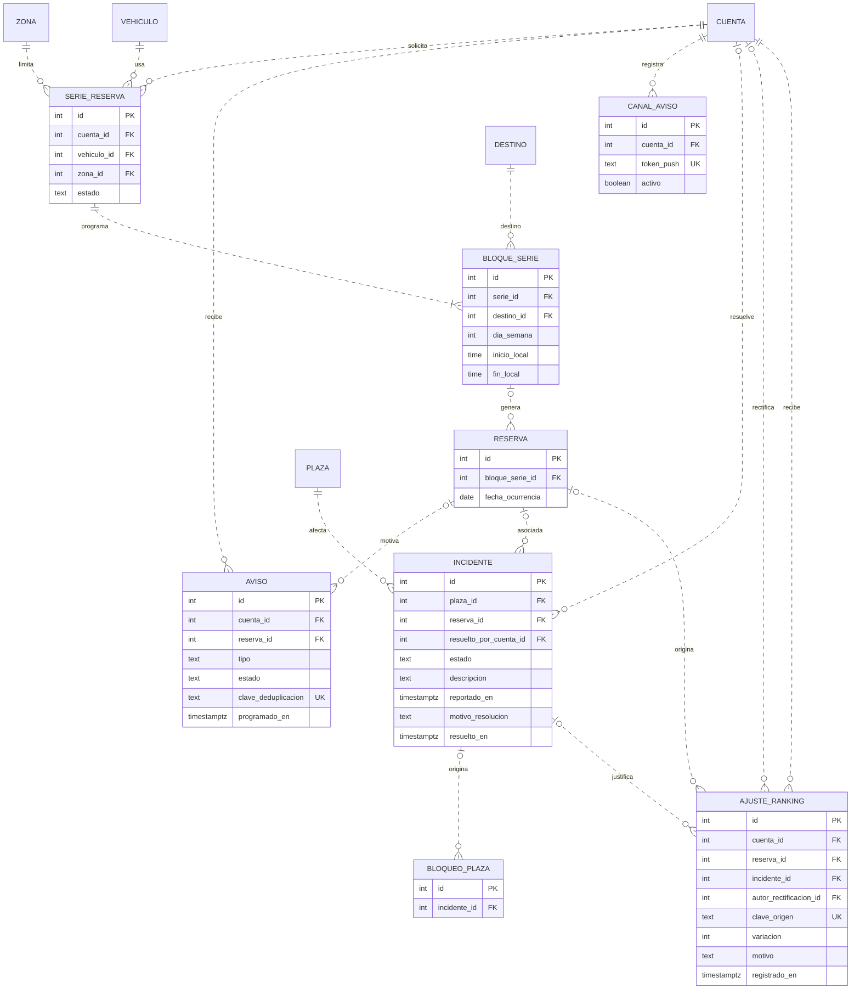

# Ampliaciones del modelo para el MVP

Las entidades de este documento se agregan al [modelo de la demo](01-demo.md) cuando las requiere el tramo correspondiente. Las tablas compartidas aparecen con los atributos que cambian o son necesarios para leer las relaciones. [Specs del MVP](../specs/README.md)

## Horarios, acceso preferente y asignación

- **Recuperación y horarios.** Consumir el token una sola vez y guardar su hash. La importación `.ics` produce bloques de clase tras la confirmación del usuario. La reserva conserva el destino e intervalo asignados aunque se edite un bloque. `origen_destino` distingue horario académico de destino declarado para medir el piloto.
- **Horario UC simulado.** `CursoUC` y `ActividadUC` guardan secciones de Buscacursos con su formato de módulos y la sala enlazada al catálogo cuando la coincidencia es única. `PerfilUC` son estudiantes de prueba y `ConexionUC` la inscripción simulada de una cuenta. Los bloques de clase registran su `origen` (`manual`, `ics` o `uc`) y la actividad UC de la que vienen, para sincronizar sin tocar los propios.
- **Accesibilidad.** La API verifica vigencia y revocación al asignar una plaza preferente. La autorización solo guarda estado administrativo y vigencia.
- **Asignación.** Excluir plazas inactivas y bloqueadas durante la ventana. Asignar una solicitud de espera una sola vez y registrar el vínculo con la reserva en la misma transacción. Usar cercanía por bloque para elegir la plaza, y ranking y antigüedad para ordenar solicitudes simultáneas compatibles. La ventana de simultaneidad sigue pendiente en 04B.

## Operación, ranking, avisos y recurrencia

- **Ranking y ocupación.** Calcular el puntaje a partir del valor inicial y los ajustes registrados una vez por hecho. Conservar los motivos de rectificación y la justificación administrativa. Distinguir la ausencia y el vencimiento de una salida registrada. Un incidente pendiente no aplica una sanción y un bloqueo por incidente verificado se conserva hasta su resolución.
- **Avisos.** Registrar cada aviso junto con el resultado que lo origina. Reintentar con la misma clave y cancelar recordatorios pendientes al finalizar o cancelar la reserva. El correo alternativo usa el correo de la cuenta.
- **Recurrencia.** Cada ocurrencia es una reserva normal y comparte las restricciones de solapamiento. Hacer único el par `bloque_serie_id` y `fecha_ocurrencia` para las reservas generadas. Una fecha cancelada conserva su registro para impedir que un reintento la vuelva a crear. Comprobar el cupo del 30 % en la misma operación que crea o renueva la serie y serializar la decisión por zona para evitar que dos operaciones consuman el mismo cupo.
- **Piloto.** Derivar ocupación e indicadores a partir de reservas, eventos e incidentes, con resultados de encuestas, monitoreo y casos de prueba de asignación como insumos adicionales. Conservar al cierre resultados agregados por período con sus denominadores y distinguir simulaciones de mediciones reales. Eliminar los datos identificables según la spec 08B.
